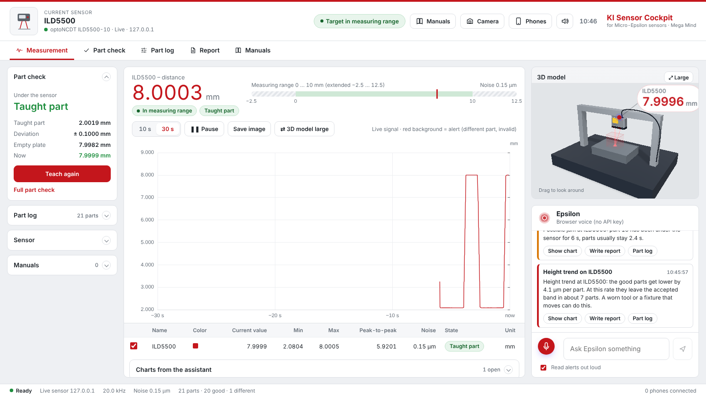

# KI Sensor Cockpit

A quality station and voice copilot for Micro-Epsilon sensors, built by team Mega Mind for the KI Sensor Cockpit
challenge at Hochschule Landshut. An optoNCDT 5500 laser sensor looks at a part on a plate. The cockpit learns one
good part, then counts and measures every part that comes under the sensor, flags every other part the moment it
lands, warns of a jam, a double feed or a height trend, and explains it all in plain words, on the screen, by voice
and on the phones of everyone in the room.




## What it does

| Feature | What you see |
| --- | --- |
| Live sensor | The optoNCDT 5500 over Ethernet at 20 kHz, in millimetres from the start of its measuring range, the same numbers as on the sensor's web page. Limits, extended range and status codes come from the data sheet, with the page. |
| Digital twin | A 3D model of the setup: the sensor, the plate and the part under the laser, green for the taught part and red for a different one, with the measuring range drawn as a band. |
| Part check | Teach the empty plate and one good part. Anything else that stays under the sensor raises **Different part detected**, with its height and how far it is from the taught part. |
| Quality station | Every part gets a number, its height above the plate, how long it stayed and its verdict. Live counter, yield and parts per minute; the part log downloads for Excel. From the rhythm of the parts it warns of a **possible jam** and a **possible double feed**; from the heights of the good parts it warns of a **height trend** before the parts leave the band. |
| Charts on request | "Show me a bar chart", "show the part heights", "show a histogram": the cockpit draws the chart and walks you through it, pointing at each finding while it speaks. |
| Voice copilot | Epsilon (OpenAI Realtime) answers questions about the sensor and the parts. Every number comes from a tool call on the real data; without a key the browser voice and typed commands still work. |
| Reports | The **Report** tab gives the run report: every part and alert of the run, with a code for the phone. One click or "write a report" on an alert: what happened, the heights of the last parts, likely causes, next steps, with the manual page. Save as PDF or scan the code to take it on a phone. |
| Manuals | Drop the Micro-Epsilon PDFs into the Manuals sheet; Epsilon answers from them and opens the page. |
| Phones | The jury scans a code and their phones flash, beep and vibrate on every alert, and list the last parts. |
| Camera and part passports | A camera (a phone over USB works) photographs every part while it lies under the sensor. Click a part in the part log for its passport: photo, height, difference to the taught part, alerts, and a code to take it on a phone. |
| Plug and play | `type: medaqlib` lets Micro-Epsilon's MEDAQLib find any supported sensor on Ethernet, USB or the serial ports. |

## Quick start (Windows)

You need Python 3.11 or newer and Node.js 22.12 or newer (the LTS version from nodejs.org).

1. Open PowerShell in the project folder.
2. Run `.\scripts\setup.ps1`. It creates the Python environment, installs everything, builds the cockpit and creates
   `backend\.env` from the example.
3. Open `backend\.env` and set `COCKPIT_TOKEN` (any password). Add `OPENAI_API_KEY` for the AI voice.
4. Connect the sensor (next section), then run `.\scripts\run.ps1`.
5. Open `http://localhost:8000/?token=<your COCKPIT_TOKEN>` in Chrome or Edge.

After a `git pull`: `cd frontend`, `npm install`, `npm run build`, `cd ..`, `.\scripts\run.ps1`, then Ctrl+F5 in the
browser.

If PowerShell says a script "is not digitally signed", run `Get-ChildItem -Recurse | Unblock-File` once in the
project folder. If scripts are disabled altogether, run `Set-ExecutionPolicy -Scope CurrentUser RemoteSigned` once.

On macOS or Linux: `./scripts/setup.sh`, edit `backend/.env`, `./scripts/run.sh`.

## Connect the optoNCDT 5500 (ILD5500) over Ethernet

The cockpit reads the sensor directly over its Ethernet interface (manual chapter 9, "Server TCP/IP"). No driver is
needed. The sensor talks only to the laptop; browsers and phones talk to the cockpit.

1. Power the sensor with 12 to 30 V DC (24 V typical): red wire to +, blue wire to 0 V.
   If the sensor says "Laser is off", connect the black wire (pin 3) to the blue wire (0 V, pin 17).
2. Plug an Ethernet cable from the sensor into the laptop.
3. Give the laptop's Ethernet adapter a fixed address: IP `169.254.168.10`, subnet mask `255.255.0.0`.
   The sensor leaves the factory with the address `169.254.168.150`.
4. Open `http://169.254.168.150`, the sensor's own web page, and set it to send its data:
   - Settings, Outputs: **Output interface** Ethernet, analog output off.
   - Ethernet settings: **Measurement value transmission** = Server TCP/IP, port `1024`.
   - Ethernet data output: tick **DIST1** only, VIDEO off. Save it as a parameter set.
5. Close the sensor's web chart and sensorTOOL, so that only the cockpit reads the sensor.
6. Let the sensor warm up for about 30 minutes, then check from `backend`:
   `.\.venv\Scripts\python.exe scripts\sensor_check.py`. It says in plain words what to fix if something is wrong.
7. In `backend\.env` set `SENSORS_FILE=config/sensors.live.yaml` (and `LIVE_SENSOR_HOST=` / `LIVE_SENSOR_PORT=` only
   if the address or port differ). Restart the cockpit.
8. The top bar says "Target in measuring range (live data)" and the status bar at the bottom says "Live sensor" with the address.

In `config/sensors.live.yaml` set the model from the sensor's label (ILD5500-10, -25, -50, -100 or -200). The model
decides the limits: 0 to 10 mm for an ILD5500-10, with the extended range from −2.5 to 12.5 mm around it (data sheet
p. 6). If the cable is pulled, the cockpit says so and the cockpit reconnects by itself. Every number on the screen comes
from the sensor: there is no simulated data behind a live sensor.

### Plug and play with MEDAQLib (optional)

MEDAQLib is Micro-Epsilon's free driver library for Windows. With it the cockpit searches for a sensor on Ethernet,
USB and the serial ports and opens the first one it finds; the Sensor panel shows the model, the interface, the address and
the serial number. Install MEDAQLib, then replace the `source:` block in `config/sensors.live.yaml` with the
commented MEDAQLib block in the same file (it names the 64-bit DLL, `sensor: auto` and an optional fixed address).
It was written from the MEDAQLib manual and tested with a stand-in for the DLL, not yet with the real sensor: for the
optoNCDT 5500 the direct Ethernet connection above is the tested way.

## Part check and quality station

1. With the plate empty, open the **Part check** tab and press **Teach the empty plate**.
2. Put one good part under the laser, hold it still and press **Teach this part**. The accepted band is the spread of
   the taught parts plus ±0.10 mm (change it in the panel; **Add another good part** widens it to your real spread).
3. From now on every part that rests under the sensor for half a second is counted when it leaves: the counter in the
   Part log panel goes up and the part appears in the part log and on the phones.
4. A different part raises **Different part detected** at once. The cockpit turns red, the 3D model paints the part red and
   every phone flashes.
5. After three parts the station knows the rhythm. A part that stays longer than 6 s is a
   **possible jam**; one that comes less than 2 s after the one before is a **possible double feed**. After eight good parts it
   fits a straight line through their heights; when the parts move towards the edge of the band, it says in how many
   parts they will leave it: a **height trend**.
6. The **Part log** tab opens the quality station sheet: counts, yield, rhythm, trend, the list of parts, the charts
   (height of every part, bar chart, height spread), **Download for Excel** and **New run**.

The taught part is kept in `backend/data/part_reference.json`, the part log in `backend/data/part_log.jsonl` (both
git-ignored), so a restart loses neither. Said honestly: a distance sensor sees the height of the top surface only. A
different part with the same height cannot be told apart, and two equal parts that follow without the plate showing
in between look like one part that stays long.

## Rehearse without the sensor

`backend/scripts/fake_ild5500.py` plays an optoNCDT 5500 on `127.0.0.1:1024` with the same Ethernet format. Start it,
set `LIVE_SENSOR_HOST=127.0.0.1` in `backend/.env` and start the cockpit.

```powershell
cd backend
.\.venv\Scripts\python.exe scripts\fake_ild5500.py --scenario line --after 15
```

`line`: the empty plate (8 mm) for 15 s, then part after part, 6 mm high; part 1 rests 8 s so you can teach it. Every
23rd part is a foreign one, the parts slowly get lower (a height trend), one follows almost at once (a double feed)
and one stays 14 s (a jam). Other scenarios: `quiet`, `parts`, `extended` (the target leaves the measuring range),
`no-target`, `out-of-range`. `--help` lists the options.

## Using the cockpit

| Key or command | What happens |
| --- | --- |
| Hold **Space**, speak | Talk to Epsilon (or type in the box) |
| "how many parts", "part log" | The quality station sheet and the counts, spoken |
| "show me a bar chart", "show the part heights", "show a histogram" | The chart, ready to explain |
| "explain this chart" | Epsilon walks through it, marking each finding |
| "write a report" | The report on the last alert |
| "teach this part" | The part check |
| **Q** | The code for the phones |
| **R** | The report on the last alert |
| **C** | Camera on and off |
| **M** | Sound on and off |
| **Delete** | Remove the front chart |
| **Escape** | Close a sheet |

### Phones

The phones join through a public address of the laptop (for example a Cloudflare tunnel:
`cloudflared tunnel --url http://localhost:8000`). Press **Q**, paste the tunnel address once (it is remembered),
and the judges scan the code. The page asks for nothing but an optional name.

### AI voice

With `OPENAI_API_KEY` in `backend/.env` the copilot speaks through the OpenAI Realtime API. The model only phrases:
counts, heights and limits come from tool calls on the real data (`get_data`, `analyze`, `get_part_check`,
`get_parts`, `make_chart`, `explain_chart`, `create_report`, `search_manual`). Without a key, the browser voice and
typed commands run the same cockpit.

## How it works

```
 optoNCDT 5500 ── Ethernet (or MEDAQLib) ── backend (FastAPI, Python)
                                              acquisition: 20 kHz averaged to 500 values per second
                                              alert rules: out of the measuring range, invalid readings
                                              part check: taught part, empty plate, different part
                                              quality station: part log, rhythm, jam, double feed, trend
                                              charts, explanations, reports, manuals
                                            ── WebSocket ── cockpit (React, three.js, ECharts)
                                                        └── phones
```

- `backend/app/sources/ild5500.py`: the sensor's Ethernet stream; `medaqlib.py`: MEDAQLib through ctypes.
- `backend/app/partcheck.py`: teaching and the different-part alert; `station.py`: the quality station.
- `backend/app/part_charts.py` and `explore.py`: the charts and their explanation steps.
- `backend/app/report.py`: the reports; `knowledge.py`: the manuals.
- `frontend/src/lib/twin.ts`: the digital twin; `components/PartsPanel.tsx`: the quality station sheet.
- `docs/CONTRACT.md`: the messages and endpoints between backend and cockpit.

## Tests

```powershell
cd backend
.\.venv\Scripts\python.exe -m pytest          # 151 tests: sensor stream, MEDAQLib, part check, quality station,
                                              # charts, reports, manuals, API and WebSockets
cd ..\frontend
npx tsc --noEmit
npm run build
```

## Troubleshooting

| Problem | Do this |
| --- | --- |
| The cockpit says "sensor not connected" | Check the cable, the laptop's address (169.254.168.10, mask 255.255.0.0) and that nothing else reads the sensor. The cockpit reconnects by itself. |
| "Connected, but no readings" | In the sensor's web page set the output interface to Ethernet and Server TCP/IP on port 1024. |
| "Most readings are invalid" | No target, the target is outside the measuring range, or the surface is too dark or shiny. The cockpit shows the sensor's own status. |
| Taking a part away raises "Different part" | Teach the empty plate in the part check. |
| The counter does not count | The station needs both the empty plate and a good part taught. |
| "Possible jam" while you talk | A part lay under the sensor much longer than the parts before. Take it away, or start a **New run** before the pitch. |
| The reading differs from the web page | The sensor was mastered or zeroed: clear it in the web page, or set `reference_mm` in `sensors.live.yaml`. |
| The page looks old after a pull | `npm run build` in `frontend`, restart, Ctrl+F5. |
| The 3D view is blank | Use Chrome or Edge (WebGL). |
